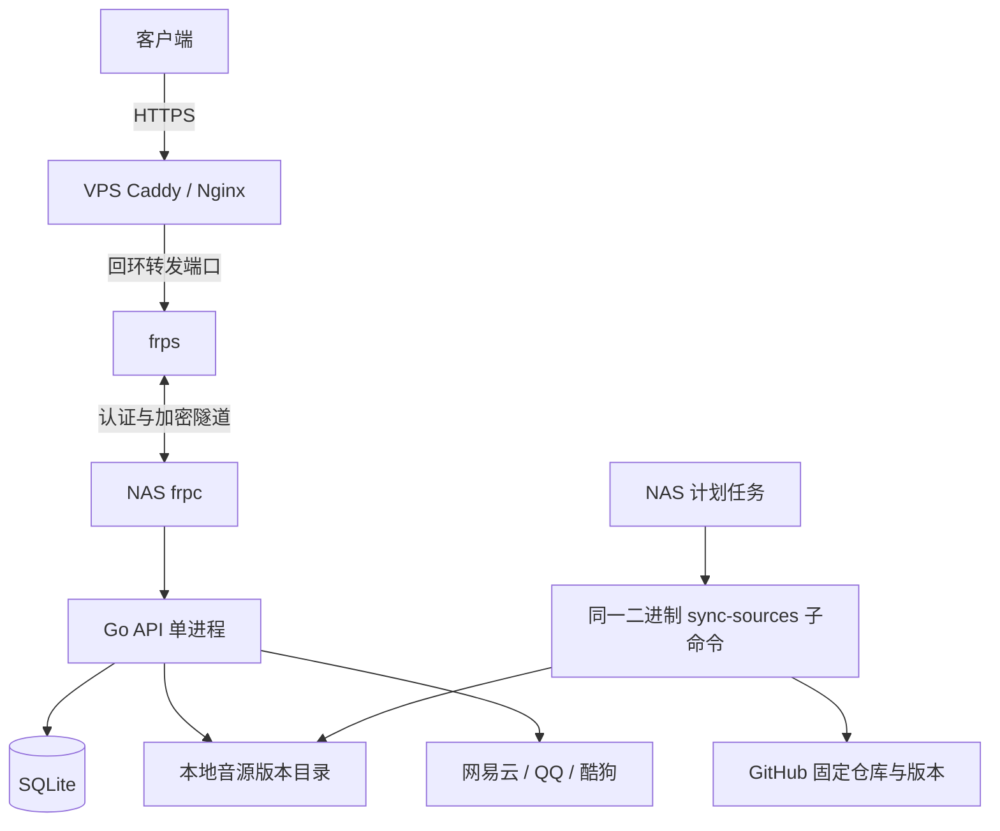

# cyapi-go：NAS 自托管迁移实施方案

状态：已开始实施，首批交付为 Go 基础服务、配置与双数据库版本化迁移。运行方法见 [开发与运行](docs/08-development.md)，实际验证见 [实施状态](docs/evidence/implementation-status.md)。已实现邮箱注册、密码登录、密码重置、Token 校验和限流；新增收藏与本地歌单（含批量增删、换源、排序和重试去重）；新增 GitHub Release ZIP 本地音源同步、公开分发和版本回滚；其他业务接口和远程歌单同步尚未迁移。

规划日期：2026-10-29。参考项目：`F:\cyapi-workers`；核对时 HEAD：`801b144db1baa2f2ae7ee7ec092e6691380b7e55`。基线以本次读取的工作区代码为准；实施前重新冻结版本并记录工作区差异。

## 目标与最终选择

采用 **Go 模块化单体 + net/http + GORM + SQLite + 本地音源目录 + NAS 定时同步 + frp**。服务单实例运行，按 NAS 架构交付二进制，可提供薄容器镜像。彻底移除运行时对 Workers、D1、R2 的依赖。

数据库以 SQLite 为默认，以 PostgreSQL 为唯一首期兼容目标：生产先用 SQLite，但关键持久化契约在两种数据库上验证。普通查询共用 GORM，确有差异的查询和 DDL 集中隔离。切换驱动与连接配置不等于自动搬迁历史数据。

音源从已配置的 GitHub 仓库同步到 NAS；Go 仅分发 JS 原始文件，不执行脚本。GitHub 不可用时继续分发上一成功版本。平台音乐接口、GitHub 更新源和 Brevo 邮件仍是外部依赖，不将“移除 Cloudflare”描述为完全离线运行。

## 阅读顺序

1. [架构、模块与资源规划](docs/01-architecture.md)
2. [数据库兼容、事务与数据迁移](docs/02-database.md)
3. [接口兼容与功能迁移规则](docs/03-api-compatibility.md)
4. [音源存储与 GitHub 同步](docs/04-source-sync.md)
5. [NAS、frp、配置和运维](docs/05-deployment.md)
6. [实施阶段、测试和发布验收](docs/06-roadmap.md)
7. [现有路由清单](docs/07-route-inventory.md)

## 部署形态

## 明确不扩展的范围

账号体系全新启用：旧账号、密码哈希、Token、二维码和验证码均不迁移，用户重新注册。旧账号关联的收藏、歌单和统计不自动导入；扫码登录首期不实现，相关路由返回未实现/404，不设置虚假可用入口。新部署使用独立生成的 AUTH_SECRET。

用户已确认 B 站、抖音不是现有已支持功能，首期排除 `/bili/*`、`/mpd/:name`、`/douyin` 及对应 Provider、Cookie 和媒体代理。旧路由清单仅作代码盘点，实际实施范围与进度见 [契约矩阵](docs/evidence/contract-matrix.md)。

首期不引入 Redis、MinIO、消息队列、微服务、分布式调度、通用插件框架。保留旧客户端接口；原项目占位接口仍按兼容契约返回，不能将“路由迁移完成”当作上游能力已实现。已识别的越权、代理目标和凭据泄露风险需修复，并单独记录兼容差异。

## 实施前待补充的信息

这些信息只阻塞相关步骤，不阻塞架构与基础模块实现：

| 信息 | 用途 | 最迟确认阶段 |
| --- | --- | --- |
| NAS 系统、CPU 架构、内存、磁盘类型 | 构建目标、SQLite 驱动和资源验收 | P1 |
| 实际 ZIP 文件集/大小、现有 NAS 任务周期与可用磁盘空间 | 已确认 guoyue2010/lxmusic- 最新正式 Release 首 ZIP 规则，待真实环境验收 | P4/P5 |
| VPS/frp 版本、域名、现有代理链 | 精确配置与真实 IP 信任边界 | P5 |
| 真实并发、上报频率、媒体代理比例 | 调整容量及性能门槛 | P5 |
| 可接受停机窗口、RPO/RTO | 最终数据切换与恢复方案 | P6 |

## 完成的定义

原客户端关键流程可用；新注册账号及其歌单数据一致；SQLite/PostgreSQL 契约测试通过；GitHub 同步失败不破坏现有脚本；公网真实 IP 和代理限制有效；NAS 资源测试、升级和备份恢复演练完成；最终运行无需 Cloudflare 凭据。各阶段证据见实施路线文档要求。